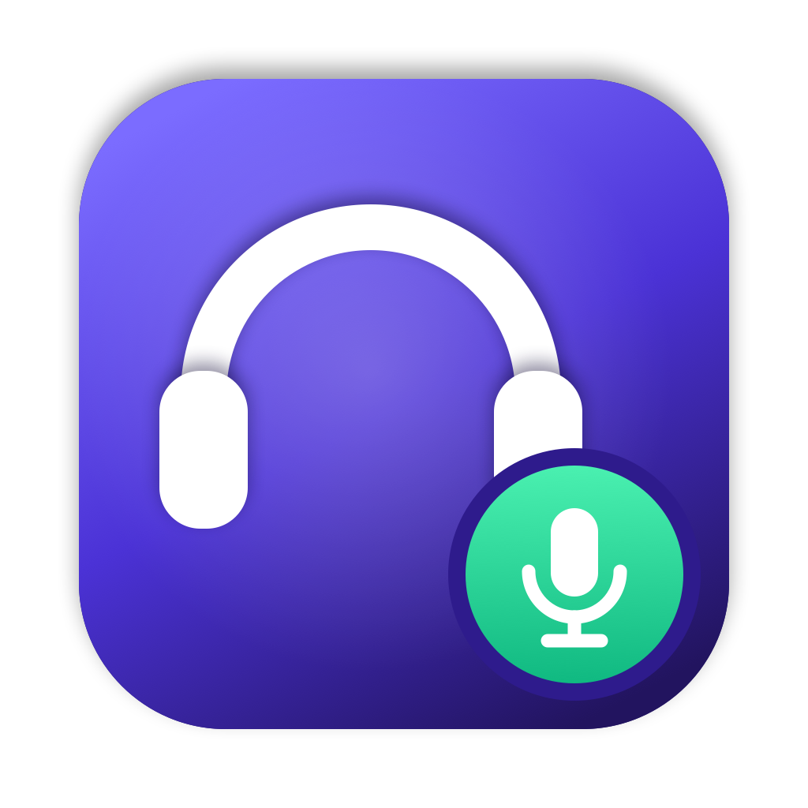

<p align="center">
  
</p>

<h1 align="center">MicSwitch</h1>

<p align="center">
  Keep <b>any</b> Bluetooth headset (TWS earbuds, neckbands, AirPods, over-ears) in <b>HD stereo</b> on macOS, and drop to call mode only while your mic is on.
</p>

<p align="center">
  
  
  
</p>

---

## The problem

Bluetooth headsets (neckbands, earbuds, AirPods...) have two modes:

| Mode | When | Sound |
|---|---|---|
| **A2DP** | Listening only | HD stereo |
| **HFP** | Any app opens the headset mic | Low-quality mono |

Join a voice channel in Discord, Meet or Zoom and macOS opens the headset mic, so music and voices turn into muffled phone-call audio. That stays true even while you are muted in the app.

## The fix

MicSwitch sits in the menu bar and decides **which microphone the system uses**:

| Icon | Mic | Headset |
|---|---|---|
| 🎧 | **OFF**: input is a silent device | A2DP, HD stereo |
| 🎙️ | **ON**: headset mic | HFP, call mode |
| 🎙️ | **ON**: Mac / USB mic (optional) | Stays HD stereo |

**Click the menu bar icon** or press **Control + Option + M** to toggle. **Right-click** for settings.

## Features

- **Works with every Bluetooth headset**: TWS earbuds, neckbands, AirPods, over-ear headphones (Classic and LE)
- **One click** on the menu bar icon (or **⌃⌥M** from anywhere) switches the mic
- **On-screen popup** shows Mic ON / Mic OFF on every switch, plus a sound cue
- **Talk Using**: talk through the headset mic, or through a Mac/USB mic so the headset **never leaves HD**
- **Several headsets?** Pick which one to manage from the right-click menu; by default it follows whatever is playing sound
- **Self-healing**: if macOS grabs the headset mic on its own (reconnects, other apps), MicSwitch puts it back
- **Tells you who's to blame**: if an app (e.g. Discord) opens the headset mic directly, MicSwitch names the app and shows the one-line fix
- **Auto mode for any call app**: mute/unmute in Discord, Zoom, Slack, Teams, Google Meet, FaceTime… as usual and MicSwitch follows (needs Accessibility permission once)
- **One-click driver install** on Macs without a mic
- **First-launch setup guide** with the 3 things you need to know
- **Open at Login** from the menu, About window, single instance
- Native Swift, no dependencies, no microphone access needed

## Requirements

- macOS 12 or later
- A silent input for "mic off". MacBooks can use the built-in mic (muted). **Macs without a mic (Mac mini, Mac Studio, Mac Pro)** need the free [BlackHole](https://existential.audio/blackhole/) driver. **MicSwitch installs it for you in one click**: it downloads the official package, checks that it is signed by Existential Audio and notarized by Apple, and asks for your Mac password once. Prefer the terminal? `brew install --cask blackhole-2ch`

## Install

```bash
git clone https://github.com/rejoanafridi/micswitch.git
cd micswitch
./build.sh
cp -R MicSwitch.app ~/Applications/
open ~/Applications/MicSwitch.app
```

**Start at login:** right-click the menu bar icon → **Open at Login**.

## Usage

1. In your call app (Discord: **Settings → Voice & Video**), set
   - **Input Device:** `Default`
   - **Output Device:** your headset (or `Default`)
2. Keep the call app itself **unmuted**. MicSwitch is your mute button now.
3. Click the menu bar icon (or press **⌃⌥M**):
   - 🎧 **Mic OFF**: you hear HD audio and nobody hears you
   - 🎙️ **Mic ON**: you can talk

Right-click the icon to:

- pick the **Headset** when more than one is connected
- choose **Talk Using**: headset mic (call quality) or a Mac/USB mic (keeps HD sound)
- turn on **Open at Login**, or reopen the **Setup Guide**

Switching to the headset mic takes 1–2 seconds and you may hear a short glitch. That is the headset changing Bluetooth profiles.

### Auto mode (any call app)

Right-click → **Auto: follow my call app's mute button**, then allow MicSwitch in **System Settings → Privacy & Security → Accessibility**. From then on, just use your call app's own mute button:

| In your call app | MicSwitch |
|---|---|
| In a call, unmuted | 🎙️ Mic ON |
| In a call, muted | 🎧 Mic OFF, HD |
| Not in a call | 🎧 Mic OFF, HD (after 3 s) |

How it works:

1. The **call app** is whichever app is recording from the mic. With Mic OFF it records silence from BlackHole, so MicSwitch knows you're in a call before you speak.
2. MicSwitch finds that app's **Mute / Unmute** control through the Accessibility API. Many apps (Discord, Zoom) keep recording while muted, so audio alone can't tell.
3. If an app has no readable mute control, MicSwitch treats "recording" as "unmuted". That is right for apps that release the mic when you mute (Google Meet does).

| App | How mute is read |
|---|---|
| Discord | "Mute" switch ✅ tested |
| Zoom | "Mute Audio / Unmute Audio" |
| Microsoft Teams | "Mute / Unmute" |
| Slack huddles | "Mute mic / Unmute mic" |
| Google Meet (Chrome, Safari, Arc, Edge) | "Turn off / Turn on microphone"; the Meet tab must be visible in its window |
| FaceTime, Webex, others | "Mute / Unmute", or recording state |

Only Discord has been tested so far. The others are based on the labels those apps use. `~/Library/Logs/MicSwitch.log` shows which control was found in each app.

> If you rebuild MicSwitch from source, macOS treats it as a new app: remove and re-add it under Accessibility.

## Troubleshooting

```bash
~/Applications/MicSwitch.app/Contents/MacOS/MicSwitch --list
```

This prints every audio device and what MicSwitch picked for the headset and for the "mic off" input.

| Message | Fix |
|---|---|
| `Mic-OFF input: none` | Right-click → **Install silent mic driver (1 click)** |
| "No Bluetooth headset is connected" | Connect your earbuds or neckband first |
| "… has no microphone" | Right-click → **Talk Using** → pick your Mac's mic |
| Still sounds bad with 🎧 / "⚠️ Discord is keeping your headset in call mode" | That app's input is set straight to the headset, which bypasses MicSwitch. In the app: **Settings → Voice & Video → Input Device → Default**. MicSwitch detects this and names the app (macOS 14+) |

## Project layout

```
main.swift            the app: devices, switching, menu bar
HUD.swift             on-screen Mic ON / OFF popup
SetupGuide.swift      first-launch guide
AutoMode.swift        Auto mode: follows any call app's mute button
DriverInstaller.swift one-click BlackHole install (signature-checked)
build.sh              builds MicSwitch.app
icon/make_icon.swift  draws the app icon
icon/AppIcon.icns     generated icon
```

## Author

**rejoanafridi** · [rejoanafridi93@gmail.com](mailto:rejoanafridi93@gmail.com) · [GitHub](https://github.com/rejoanafridi)

## License

[MIT](LICENSE) © 2026 rejoanafridi
